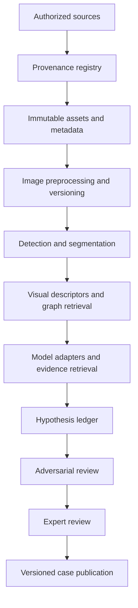

# Technical Architecture

## Design goals

- Evidence and provenance are first-class data.
- Original assets are immutable; transformations are versioned.
- Models are interchangeable and evaluated against stable baselines.
- Retrieval returns cited source records, not unsupported generated claims.
- Human review is a required stage for scholarly conclusions.

## Conceptual pipeline

## Prototype stack

Start simple:
- Python for ingestion, image processing, experiments, and evaluation.
- Pydantic or JSON Schema for validated records.
- SQLite for a local prototype; PostgreSQL when multi-user workflows are needed.
- Local object storage or a documented filesystem layout for authorized assets.
- Vector search for visual/textual retrieval, with the embedding model and index version recorded.
- A lightweight CLI or notebook interface before building a full web application.

Possible later components: FastAPI, PostgreSQL, object storage, vector database, experiment tracking, and a review UI.

## Model adapter contract

Each experiment should record:
- provider and exact model identifier;
- model family and modality;
- run timestamp;
- prompt and system-instruction version;
- decoding parameters;
- input asset identifiers and transformations;
- output schema and raw response where permitted;
- latency, token usage, and cost where available;
- errors, retries, and human corrections.

Compare frontier multimodal models with reproducible open models and non-neural baselines. Provider aliases such as “latest” are insufficient for reproducibility; capture the exact model ID returned by the provider.

## Retrieval and grounding

- Index only resources whose use is permitted.
- Store citation metadata alongside every retrieved passage or image occurrence.
- Require exact source locators for evidence claims.
- Keep generated summaries separate from source text.
- Include counter-evidence retrieval, not just nearest positive matches.

## Data and asset safety

- Never overwrite source images.
- Store hashes for source and derived assets.
- Record crop coordinates, rotation, enhancement, and segmentation versions.
- Do not send unpublished, restricted, or rights-unclear material to external model APIs.
- Apply access controls to any material that cannot be openly redistributed.

## Evaluation and deployment

The evaluation harness should be independent of model adapters. Pin datasets, splits, preprocessing, prompts, and metric versions. Split at artifact/source level to prevent near-duplicate crops from leaking across train and test. A model update should trigger a benchmark run before its output is used in published analysis.